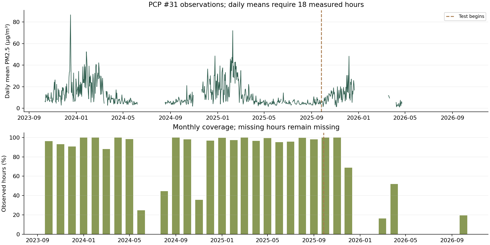
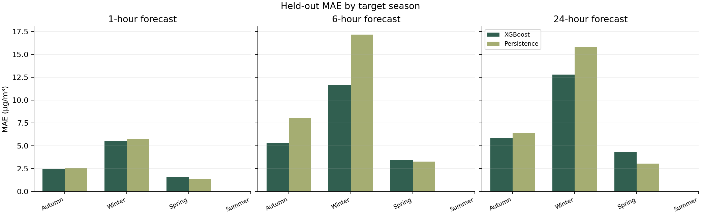
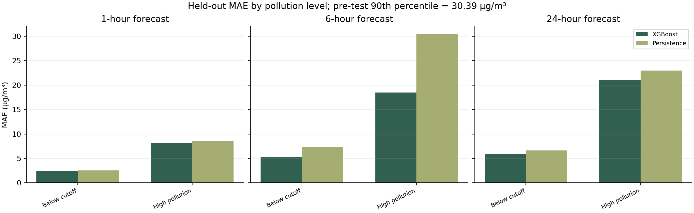
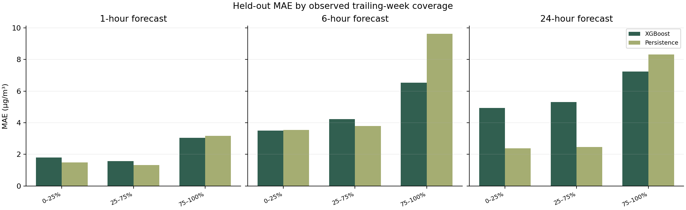
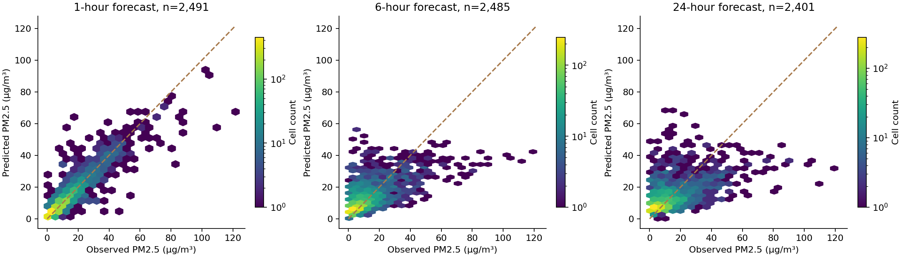

# Extended held-out analysis for PCP 31

This analysis uses the immutable training snapshot and fixed held-out evaluation predictions. No models were trained, parameters changed, or deployment predictions used as test results. All errors are in µg/m³. Positive bias means overprediction; negative bias means underprediction.

The clearest result is the six-hour improvement. The paired weekly-block interval versus persistence excludes zero at six hours, but includes zero at one and 24 hours. Winter errors are larger than autumn or spring errors, summer is absent from the test set, and spring MAE is worse than persistence at all three horizons. Sparse-history examples also expose a next-day weakness despite the lower overall average error.

## Overall performance

| horizon_hours | samples | MAE | RMSE | bias | p90_absolute_error |
|---|---|---|---|---|---|
| 1 | 2491 | 2.94 | 5.27 | 0.26 | 6.26 |
| 6 | 2485 | 6.33 | 9.79 | 0.79 | 14.70 |
| 24 | 2401 | 7.12 | 10.79 | 0.63 | 16.15 |

Compare MAE to both persistence and the same-hour-yesterday baseline. The latter equals persistence at the 24-hour horizon, so those are not independent benchmarks.

## Data coverage

The three-year grid contains 17,246 observations out of 26,281 hours (65.6%). The latest month represented in the test predictions is 2026-10. Calendar gaps are not evidence of zero pollution. Selection excludes unobserved targets and poorly covered days, so these scores describe eligible examples rather than continuous operational coverage.

The first and last coverage months are partial, bounded by the experiment grid rather than full calendar months. Monthly CSV denominators show the number of hours actually covered by that grid.

## Seasonal errors

| horizon_hours | season | samples | MAE | RMSE | bias |
|---|---|---|---|---|---|
| 1 | Autumn | 1592 | 2.42 | 3.74 | 0.26 |
| 1 | Spring | 385 | 1.61 | 2.06 | 0.63 |
| 1 | Winter | 514 | 5.53 | 9.38 | -0.03 |
| 6 | Autumn | 1587 | 5.34 | 7.52 | 0.54 |
| 6 | Spring | 385 | 3.40 | 4.22 | 2.44 |
| 6 | Winter | 513 | 11.61 | 16.62 | 0.34 |
| 24 | Autumn | 1552 | 5.84 | 8.06 | 0.51 |
| 24 | Spring | 334 | 4.30 | 5.18 | 3.46 |
| 24 | Winter | 515 | 12.81 | 18.15 | -0.85 |

Seasons are assigned using target time in Asia/Almaty. Unrepresented test seasons: Summer. Blank bars mean no eligible test examples, not zero error. Seasons have unequal sample sizes and pollution distributions; comparisons do not isolate a causal seasonal effect.

## Pollution peaks

The high-pollution cutoff is the 90th percentile of observed pre-test station concentrations: **30.39 µg/m³**. This is a statistical threshold, not a health guideline. It is fixed without using test concentration quantiles.

| horizon_hours | model | samples | MAE | RMSE | bias |
|---|---|---|---|---|---|
| 1 | XGBoost | 195 | 8.14 | 12.30 | -4.79 |
| 1 | Persistence | 195 | 8.60 | 12.44 | -3.81 |
| 1 | Same hour yesterday | 195 | 23.01 | 26.84 | -20.91 |
| 6 | XGBoost | 195 | 18.52 | 23.26 | -18.08 |
| 6 | Persistence | 195 | 30.50 | 35.48 | -27.48 |
| 6 | Same hour yesterday | 195 | 23.01 | 26.84 | -20.91 |
| 24 | XGBoost | 195 | 21.03 | 25.38 | -20.56 |
| 24 | Persistence | 195 | 23.01 | 26.84 | -20.91 |
| 24 | Same hour yesterday | 195 | 23.01 | 26.84 | -20.91 |

For high-pollution 24-hour targets, XGBoost MAE is 21.03, with bias -20.56. This indicates substantial underprediction during large episodes even though its peak MAE is lower than persistence.

Compare the high-pollution subgroup to the overall average and baselines. A lower overall MAE does not guarantee better forecasts during pollution episodes. Negative peak bias indicates systematic underprediction of high concentrations.

## Missing history

| horizon_hours | model | samples | MAE | RMSE | bias |
|---|---|---|---|---|---|
| 1 | XGBoost | 56 | 1.80 | 2.32 | 0.81 |
| 1 | Persistence | 56 | 1.49 | 2.18 | -0.07 |
| 1 | Same hour yesterday | 56 | 3.94 | 4.54 | 1.77 |
| 6 | XGBoost | 67 | 3.49 | 3.92 | 2.73 |
| 6 | Persistence | 67 | 3.54 | 5.12 | 0.44 |
| 6 | Same hour yesterday | 67 | 3.81 | 4.39 | 1.74 |
| 24 | XGBoost | 52 | 4.94 | 5.70 | 4.31 |
| 24 | Persistence | 52 | 2.38 | 3.13 | -0.14 |
| 24 | Same hour yesterday | 52 | 2.38 | 3.13 | -0.14 |

Coverage groups count actual observations in the trailing 168 hours: 0–25% means at most 42 observations, 25–75% means 43–126, and 75–100% means 127–168. Daily eligibility still requires at least 18 of 24 hours. The latest inference snapshot at training had 44/168 observations, putting it in the middle group. These comparisons are observational: pollution levels, calendar period, and missingness change together. They do not prove that missing data causes the differences. The separate missing_feature_errors.csv groups examples by missing feature count before imputation.

Aggregating all examples with at most 75% weekly coverage gives the following comparison. The 24-hour model loses to persistence in both individual sparse-coverage bins. This failure must be presented alongside overall gains.

| horizon_hours | model | samples | MAE | RMSE | bias |
|---|---|---|---|---|---|
| 1 | XGBoost | 189 | 1.64 | 2.02 | 0.77 |
| 1 | Persistence | 189 | 1.37 | 1.96 | 0.02 |
| 1 | Same hour yesterday | 189 | 2.85 | 3.60 | 0.80 |
| 6 | XGBoost | 189 | 3.97 | 4.74 | 3.54 |
| 6 | Persistence | 189 | 3.70 | 5.24 | 0.14 |
| 6 | Same hour yesterday | 189 | 2.85 | 3.60 | 0.80 |
| 24 | XGBoost | 138 | 5.17 | 5.99 | 4.82 |
| 24 | Persistence | 138 | 2.44 | 3.15 | 0.50 |
| 24 | Same hour yesterday | 138 | 2.44 | 3.15 | 0.50 |
## Recent period

| horizon_hours | model | samples | MAE | RMSE | bias |
|---|---|---|---|---|---|
| 1 | XGBoost | 20 | 1.43 | 1.93 | 0.44 |
| 1 | Persistence | 20 | 1.51 | 2.12 | 0.16 |
| 1 | Same hour yesterday | 20 | 2.60 | 3.28 | -1.26 |
| 6 | XGBoost | 20 | 2.82 | 3.09 | 2.06 |
| 6 | Persistence | 20 | 3.00 | 3.87 | 0.93 |
| 6 | Same hour yesterday | 20 | 2.60 | 3.28 | -1.26 |
| 24 | XGBoost | 3 | 3.55 | 3.60 | 3.55 |
| 24 | Persistence | 3 | 3.12 | 3.12 | 3.12 |
| 24 | Same hour yesterday | 3 | 3.12 | 3.12 | 3.12 |

The most recent month is a very small, narrow sample. In particular, three 24-hour examples cannot establish robust next-day performance or accuracy across pollution regimes. Monthly and yearly CSVs allow the commission to inspect where the overall results come from.

## Paired uncertainty in baseline improvement

| horizon_hours | baseline | samples | blocks | MAE_gain | lower_95 | upper_95 |
|---|---|---|---|---|---|---|
| 1 | Persistence | 2491 | 19 | 0.09 | -0.04 | 0.24 |
| 1 | Same hour yesterday | 2491 | 19 | 4.87 | 3.40 | 6.63 |
| 6 | Persistence | 2485 | 19 | 2.85 | 1.41 | 4.30 |
| 6 | Same hour yesterday | 2485 | 19 | 1.48 | 0.67 | 2.34 |
| 24 | Persistence | 2401 | 19 | 0.86 | -0.04 | 1.64 |
| 24 | Same hour yesterday | 2401 | 19 | 0.86 | -0.04 | 1.64 |

Positive MAE gain means XGBoost has lower absolute error than the baseline. The approximate 95% interval resamples 2,000 sets of seven-calendar-day blocks with replacement and compares forecasts on identical test rows. Intervals spanning zero do not clearly establish an improvement under this procedure. Gaps, unequal block sizes, few blocks, nonstationarity, and dependence beyond one week limit interpretation. These intervals describe aggregate error differences; they are not prediction intervals for tomorrow.

## Largest misses

| horizon_hours | origin | target_time | target | predicted | absolute_error | signed_error | observed_168h |
|---|---|---|---|---|---|---|---|
| 1 | 2025-12-07 13:00:00+00:00 | 2025-12-07 14:00:00+00:00 | 109.80 | 55.79 | 54.01 | -54.01 | 166 |
| 1 | 2025-12-07 12:00:00+00:00 | 2025-12-07 13:00:00+00:00 | 121.75 | 68.29 | 53.46 | -53.46 | 166 |
| 1 | 2025-12-20 13:00:00+00:00 | 2025-12-20 14:00:00+00:00 | 10.57 | 57.41 | 46.84 | 46.84 | 168 |
| 6 | 2025-12-07 07:00:00+00:00 | 2025-12-07 13:00:00+00:00 | 121.75 | 41.76 | 79.99 | -79.99 | 166 |
| 6 | 2025-12-07 08:00:00+00:00 | 2025-12-07 14:00:00+00:00 | 109.80 | 36.28 | 73.52 | -73.52 | 166 |
| 6 | 2025-12-04 05:00:00+00:00 | 2025-12-04 11:00:00+00:00 | 104.62 | 38.73 | 65.89 | -65.89 | 168 |
| 24 | 2025-12-06 13:00:00+00:00 | 2025-12-07 13:00:00+00:00 | 121.75 | 31.62 | 90.13 | -90.13 | 166 |
| 24 | 2025-12-06 14:00:00+00:00 | 2025-12-07 14:00:00+00:00 | 109.80 | 23.11 | 86.69 | -86.69 | 166 |
| 24 | 2025-12-03 10:00:00+00:00 | 2025-12-04 10:00:00+00:00 | 102.15 | 33.95 | 68.20 | -68.20 | 168 |

Times in this table are UTC. largest_errors.csv saves ten misses per horizon. Inspect whether the model lags rapid rises, overpredicts after declines, or misses large episodes. These cases are selected retrospectively and are not representative random examples.

## Interpretation for the defense

See the project-wide [model failure discussion](../../../MODEL_FAILURES.md) for the original US Embassy peak-error reversal, PCP #31 baseline losses, concrete misses, interpretation, and a suggested defense explanation.

Present average gains together with subgroup failures and sample counts. Explain that these are station-level PM2.5 point forecasts from the latest published measured hour, with daily publication delays and sparse recent history. Do not claim citywide, continuous live, health-alert, or all-season validation. No weather is used. Any future changes motivated by these test diagnostics require a new untouched evaluation period; do not reuse this test set for tuning.

## Reproduction

Run `backend/.venv/Scripts/python.exe -m backend.analyze_current` from the project root. This uses data/current_training_pm25.csv.gz, artifacts/current/experiment.json, and artifacts/current/test_predictions.csv. Refreshing the inference snapshot does not change these analysis inputs. Install backend/requirements-analysis.txt for plotting dependencies. Outputs include machine-readable subgroup metrics, enriched test predictions, confidence comparisons, five figures, and this report.
